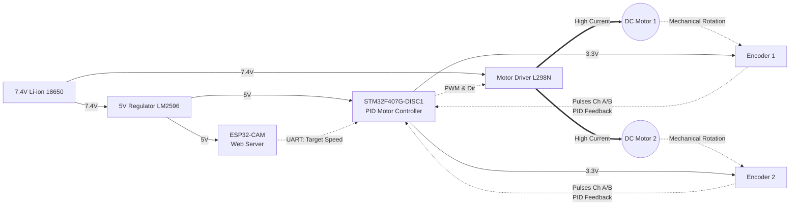
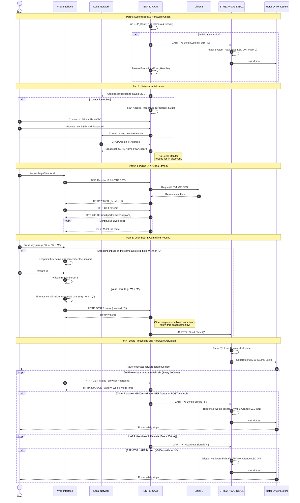
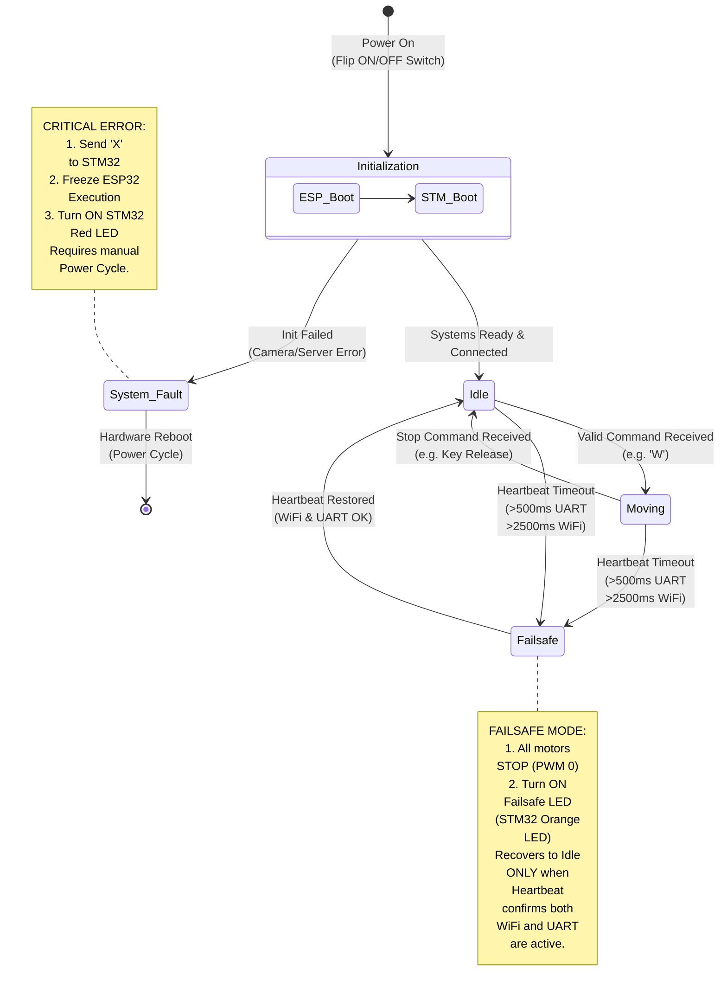

# D.A.R.T. Rover
**Dual Architecture Rover Technology**

Current Project Status: *in progress*

The *D.A.R.T. Rover* is a **Dual-MCU robotic 2WD vehicle** designed for real-time teleoperation. It bridges the gap between embedded hardware engineering and web technologies, providing a **video-game-like experience** through live first-person view streaming and low-latency WASD keyboard controls directly from a web browser.

## Project Goal

Originally conceived as a university project, this repository represents a pursuit of professional engineering standards. The main objective is to **design**, **document** and **implement** a robust, production-grade, prototype by focusing on:
* **Advanced Embedded Architecture:** Implementing a Master-Slave dual-microcontroller system (ESP32-CAM and STM32F407G-DISC1) to decouple high-bandwidth networks from deterministic hardware control.
* **Mechanical & CAD Design:** Developing a fully custom 3D-printed chassis and body work using Fusion 360.
* **Software Best Practices:** Writing modular C/C++ firmware and JavaScript web clients, complemented by UML documentation and proper Git version control.

## Key Features

* **Dual-MCU Architecture:** ESP32-CAM (Network & Video) + STM32F407G-DISC1 (Real-time Motor Control) providing minimal latency and fine control over speed.
* **Defensive Web Client:** First-key-wins handling for opposing inputs on the same axis. A second held key is remembered and takes over when the first key is released (e.g. hold 'W', then 'S', then release 'W' to switch to 'S').
* **Heartbeat Failsafe:** Real-time connection monitoring that forces motors to halt upon signal loss.
* **Security**: Only one driver at a time is permitted, and the driver is automatically disconnected after 2.5 seconds without a request (`GET /status` or `POST /control`).
* **mDNS Discovery:** Plug-and-play network access via `http://dart.local`, eliminating the need for hardcoded IPs or Serial Monitor debugging.
* **Magnetic Quick-Release Bodywork:** Custom 3D-printed shell secured with neodymium magnets for instant hardware access and LED diagnostics

## **R.D.T.** Serial Protocol
*Rover Data Transport*

* **Physical bus:** UART, 115200 baud, 8N1, no hardware flow control
* **Link:** ESP32-CAM <-> STM32F407G-DISC1
* **Data frame:** `Start | Type | Length | Payload | CRC-8`
  * `Start`: one byte with the fixed value `0xAA`
  * `Type`: one byte; `0x01` = control, `0x02` = status, `0x03` = handshake
  * `Length`: one byte containing the payload length in bytes (counts unescaped bytes)
  * `Payload`: `0` to `255` bytes of message data
  * `CRC-8`: calculated over `Type | Length | Payload`
    * Polynomial: `0x07`
    * Initial value: `0x00`
    * Input and output reflection: none
    * Final XOR value: `0x00`
    * One-byte CRC calculated using the MSB-first algorithm
    * Calculated before escaping and validated after unescaping
* **Status payload:** `Type = RDT_STATUS_TYPE`, `Length = RDT_STATUS_LENGTH`
  * Layout: `<battery><speed>`
  * `battery`: four ASCII bytes in the `a.bc` format, measured in volts
  * `speed`: four ASCII bytes in the `a.bc` format, measured in meters per second
  * The complete payload is eight ASCII bytes with no separator. For example,
    `7.40` and `1.25` are transmitted as `7.401.25`.
* **Handshake:**
  * The STM32 sends `RDT_STM_REQ` every `RDT_STM_REQUEST_PERIOD_MS`.
  * A handshake request uses `Type = RDT_HANDSHAKE_TYPE`, `Length = RDT_HANDSHAKE_LENGTH`,
    and `Payload = RDT_STM_REQ`.
  * After the first valid request, the ESP32 starts the request counter.
  * Each subsequent valid request must arrive within `RDT_REQUEST_INTERVAL_TIMEOUT_MS`
    of the previous valid request.
  * If the timeout expires, the request counter resets and the next valid
    request starts a new handshake attempt.
  * A request is valid only when its complete frame passes CRC validation;
    invalid requests do not increment the counter.
  * After `RDT_REQUIRED_VALID_REQUESTS` consecutive valid requests, the ESP32
    responds with a frame using `Type = RDT_HANDSHAKE_TYPE`,
    `Length = RDT_HANDSHAKE_LENGTH`, and `Payload = RDT_ESP_OK`.
  * The STM32 transitions to `Online` after receiving a valid `RDT_ESP_OK`
    frame.
  * The handshake must be established within `RDT_HANDSHAKE_TIMEOUT_MS`, or
    systems enter `SystemFault` at `Boot State`, or `Failsafe` at `Idle State`
    / `Moving State`.
  * Handshake timeout timer starts when boot/recovery begins.
  * Runtime recovery uses the same handshake procedure.
* **Runtime monitoring:**
  * The ESP32 sends the current control payload every `RDT_ESP_CONTROL_PERIOD_MS`.
  * The STM32 refreshes its control watchdog only after receiving a complete,
    valid control frame.
  * If no valid control frame arrives within `RDT_STM_CONTROL_TIMEOUT_MS`, the
    STM32 stops the motors and enters `Failsafe`.
  * After a runtime watchdog timeout, recovery from `Failsafe` uses the same
    handshake procedure.
  * The STM32 sends a status frame every `RDT_STM_STATUS_PERIOD_MS`.
  * The ESP32 refreshes its status watchdog only after receiving a complete,
    valid status frame.
  * If no valid status frame arrives within `RDT_ESP_STATUS_TIMEOUT_MS`, the
    ESP32 enters `Failsafe`.
  * The browser sends `GET /status` every `RDT_BROWSER_REQUEST_PERIOD_MS`.
  * Only `GET /status` refreshes the browser watchdog. `POST /control` does not.
  * If no `GET /status` arrives within `RDT_BROWSER_TIMEOUT_MS`, the ESP32
    considers the driver disconnected, sends `RDT_CONTROL_FAILSAFE`, and stops
    sending movement commands.
* **CRC Failure:** The receiver discards the complete frame and does not apply its payload or request a retry.
* **Escaping:** Applied to every byte after `Start`, including `Type`, `Length`, `Payload` and `CRC-8`.
  * `0x7D 0xAA` represents byte `0xAA`
  * `0x7D 0x7D` represents byte `0x7D`
  * All other bytes pass through unchanged
* **Constants:**
  * **Frame:**
    * `RDT_START_BYTE` = `0xAA`
    * `RDT_ESCAPE_BYTE` = `0x7D`
    * `RDT_CRC8_POLYNOMIAL` = `0x07`
  * **Message types and lengths:**
    * `RDT_CONTROL_TYPE` = `0x01`
    * `RDT_STATUS_TYPE` = `0x02`
    * `RDT_HANDSHAKE_TYPE` = `0x03`
    * `RDT_CONTROL_LENGTH` = `0x01`
    * `RDT_STATUS_LENGTH` = `0x08`
    * `RDT_HANDSHAKE_LENGTH` = `0x01`
  * **Handshake:**
    * `RDT_STM_REQ` = `0x60`
    * `RDT_ESP_OK` = `0x61`
    * `RDT_REQUIRED_VALID_REQUESTS` = `3U`
    * `RDT_STM_REQUEST_PERIOD_MS` = `50U`
    * `RDT_REQUEST_INTERVAL_TIMEOUT_MS` = `100U`
    * `RDT_HANDSHAKE_TIMEOUT_MS` = `1000U`
  * **Watchdogs:**
    * `RDT_ESP_CONTROL_PERIOD_MS` = `50U`
    * `RDT_STM_CONTROL_TIMEOUT_MS` = `200U`
    * `RDT_STM_STATUS_PERIOD_MS` = `500U`
    * `RDT_ESP_STATUS_TIMEOUT_MS` = `1500U`
    * `RDT_BROWSER_REQUEST_PERIOD_MS` = `500U`
    * `RDT_BROWSER_TIMEOUT_MS` = `1500U`
  * **Control payloads:**
    * `RDT_CONTROL_FORWARD` = `0x80`
    * `RDT_CONTROL_FORWARD_LEFT` = `0x81`
    * `RDT_CONTROL_LEFT` = `0x82`
    * `RDT_CONTROL_BACKWARD_LEFT` = `0x83`
    * `RDT_CONTROL_BACKWARD` = `0x84`
    * `RDT_CONTROL_BACKWARD_RIGHT` = `0x85`
    * `RDT_CONTROL_RIGHT` = `0x86`
    * `RDT_CONTROL_FORWARD_RIGHT` = `0x87`
    * `RDT_CONTROL_STOP` = `0x88`
    * `RDT_CONTROL_SYSTEM_FAULT` = `0x91`
    * `RDT_CONTROL_FAILSAFE` = `0x92`

## Architecture Diagram

## Sequence Diagram

## State Machine Diagram

