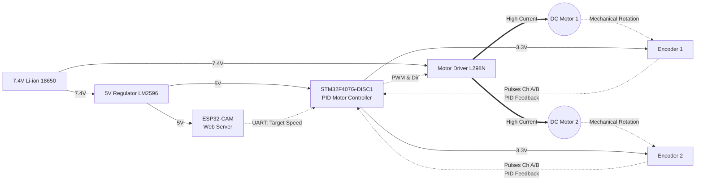
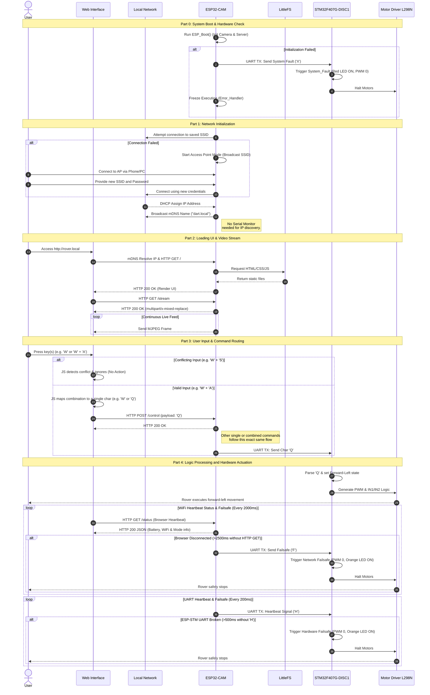
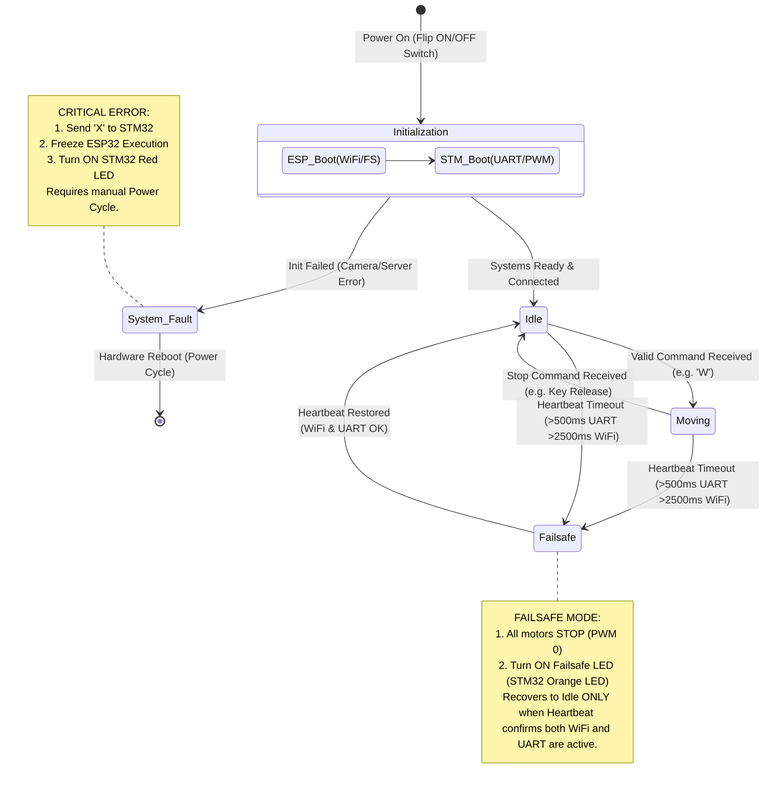

# D.A.R.T. Rover
**Dual Architecture Rover Technology**

Current Project Status: *in progress*

The *D.A.R.T. Rover* is a **Dual-MCU robotic 2WD vehicle** designed for real-time teleoperation. It bridges the gap between embedded hardware engineering and web technologies, providing a **video-game-like experience** through live first-person view streaming and low-latency WASD keyboard controls directly from a web browser.

## Project Goal

Originally conceived as a university project, this repository represents a pursuit of professional engineering standards. The main objective is to **design**, **document** and **implement** a robust, production-grade, prototype by focusing on:
* **Advanced Embedded Architecture:** Implementing a Master-Slave dual-microcontroller system (ESP32-CAM and STM32F407G-DISC1) to decouple high-bandwidth networks from deterministic hardware control.
* **Mechanical & CAD Design:** Developing a fully custom 3D-printed chassis and body work using Fusion 360.
* **Software Best Practices:** Writing modular C/C++ firmware and JavaScript web clients, complemented by UML documentation and proper Git version control.

## Key Features

* **Dual-MCU Architecture:** ESP32-CAM (Network & Video) + STM32F407G-DISC1 (Real-time Motor Control) providing minimal latency and fine control over speed.
* **Defensive Web Client:** JS-level input filtering for conflicting commands (e.g. 'W' + 'S').
* **Heartbeat Failsafe:** Real-time connection monitoring that forces motors to halt upon signal loss.
* **Security**: Only one driver at the time is permitted and it's automatically disconnected after 2 seconds of no status request (no GET /status performed by browser)
* **mDNS Discovery:** Plug-and-play network access via `http://rover.local`. eliminating the need for hardcoded IPs or Serial Monitor debugging.
* **Magnetic Quick-Release Bodywork:** Custom 3D-printed shell secured with neodymium magnets for instant hardware access and LED diagnostics

## How to Run

*(in progress)* 

## Hardware Wiring

*(in progress)*

## Architecture Diagram

## Sequence Diagram

## State Machine Diagram

