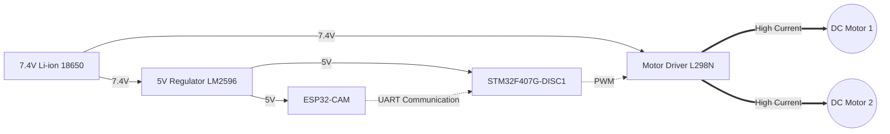
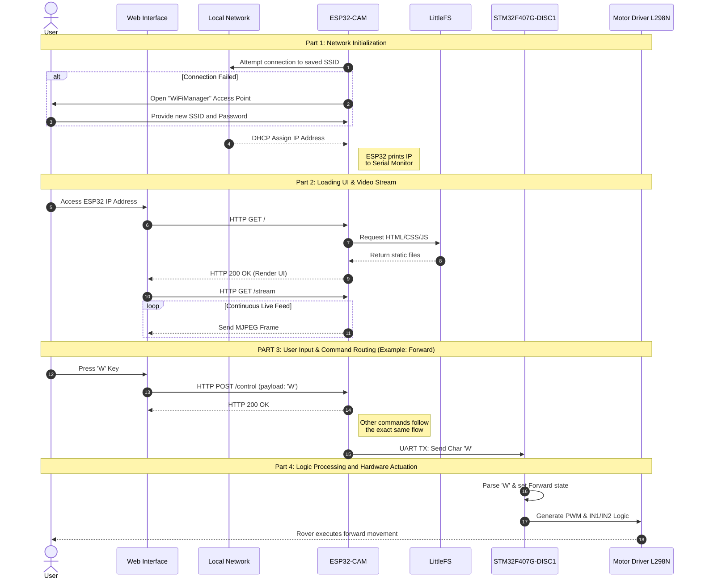

# WiFi_Rover

The *WiFi Rover* is a **Dual-MCU robotic 2WD vehicle** designed for real-time teleoperation. It bridges the gap between embedded hardware engineering and web technologies, providing a **video-game-like experience** through live first-person view streaming and low-latency WASD keyboard controls directly from a web browser.

## Project Goal

Originally conceived as a university project, this repository represents a pursuit of professional engineering standards. The main objective is to **design**, **document** and **implement** a robust, production-grade, prototype by focusing on:
* **Advanced Embedded Architecture**: Implementing a Master-Slave dual-microcontroller system (ESP32-CAM and STM32F407G-DISC1) to decouple high-bandwidth networks from deterministic hardware control.
* **Mechanical & CAD Design**: Developing a fully custom 3D-printed chassis and body work using Fusion 360.
* **Software Best Practices**: Writing modular C/C++ firmware and JavaScript web clients, complemented by UML documentation and proper Git version control.

## Architecture Diagram

## Sequence Diagram

